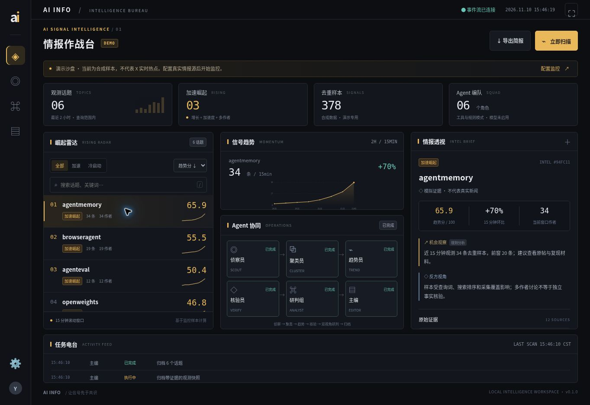

# AI INFO · AI 情报作战台

面向 X 的免费 AI 资讯情报台：发现**正在起势的话题**，追踪原帖证据，并在作战大屏上观察多角色协作。

**不接 X 官方付费 API，不需要收费模型，不需要 Docker。** 默认使用免费浏览器采集与规则研判；可选本机 Ollama。只在自己的电脑上运行。

## 已实现

- **崛起雷达**：15 分钟滚动窗口，近 2 小时曲线；增长、加速度、独立作者与新鲜度联合评分，冷启动单独标记。
- **免费采集**：OpenCLI 使用已登录的 Chrome 读取 X **Latest / 最新**动态；Agent Reach 可选，明确标记为热门排序抽样。
- **多角色协作**：侦察员 → 聚类员 → 趋势员 → 核验员 → 研判组 → 主编。采集、核验可并发；研判组可由本地模型分别扮演机会与质疑角色。
- **作战大屏**：崛起榜、趋势曲线、Agent 状态、原始证据、任务电台、情报源配置、运行档案、全屏模式和 Markdown 简报导出。
- **持续监控**：手动扫描、可配置后台间隔、取消、SSE 断线重连、SQLite 持久化、失败保留完整快照、限流冷却。
- **免费规则模式**：不用模型也能完成采集、聚类、评分、来源校验和模板简报；页面明确标记规则分析。
- **隔离演示**：无需 X 登录即可体验合成数据；不会作为真实热点展示或混入真实观测。



## 快速启动

需要 Python 3.12+；采集需要 Chrome、Node.js 20.18.1+。前端无构建步骤。

### Windows（推荐）

双击 `启动情报台.bat`，或在 PowerShell 中运行：

```powershell
python -m venv .venv
.\.venv\Scripts\python.exe -m pip install -r requirements.txt
.\.venv\Scripts\python.exe -m intel
```

打开 **http://127.0.0.1:8766**。默认选择 OpenCLI；先看效果可在「配置监控」切换到演示模式，然后点击「立即扫描」。

### macOS / Linux

```bash
python3 -m venv .venv
.venv/bin/python -m pip install -r requirements.txt
.venv/bin/python -m intel
```

或运行 `bash scripts/start.sh`。默认只监听 `127.0.0.1:8766`。

## 免费接入 X（推荐 OpenCLI）

1. 安装 [Node.js](https://nodejs.org/) 与 Chrome。
2. 在终端运行：

   ```bash
   npm install -g @jackwener/opencli
   ```

3. 在 Chrome 安装 [官方 OpenCLI Browser Bridge 扩展](https://chromewebstore.google.com/detail/opencli/ildkmabpimmkaediidaifkhjpohdnifk)，然后**自行在 Chrome 登录 X**，保持浏览器运行。
4. 检查连接与最新搜索：

   ```bash
   opencli doctor
   opencli twitter search "AI agent" --product live --exclude retweets --limit 10 -f json
   ```

5. 作战台「配置监控」选择 **OpenCLI · X 最新动态**，点击立即扫描。确认结果正常后再开启「后台自动扫描」。

有多个 Chrome 配置时，先通过 `opencli profile list` / `opencli profile use <别名或ID>` 选择已登录 X 的配置。采集只读搜索，不发帖、不点赞、不私信；本项目不导出或保存浏览器密码、Cookie。

Agent Reach 可选接入、异常处理和查询示例见 [免费接入说明](docs/FREE_SETUP.md)。

## 可选：本地 Ollama 多 Agent 研判

不安装模型也能使用所有规则功能。想让机会分析员与质疑分析员分别写中文分析，可安装 [Ollama](https://ollama.com/)，下载适合自己电脑的**本地模型**：

```bash
ollama pull qwen3:8b
```

在启动工作台的终端设置模型名：

```powershell
# PowerShell
$env:OLLAMA_MODEL="qwen3:8b"
.\.venv\Scripts\python.exe -m intel
```

```bash
# macOS / Linux
export OLLAMA_MODEL=qwen3:8b
.venv/bin/python -m intel
```

然后在「配置监控」启用本地 Ollama 研判。默认地址 `http://127.0.0.1:11434`，可通过 `OLLAMA_BASE_URL` 改本机端口。只接受回环地址，拒绝 Cloud 模型名，不提供云端计费入口。前 5 个话题每轮最多 10 次本地调用；失败或引用校验不通过会明确退回规则分析。

## 观测范围

这是**查询范围内的免费抽样雷达**，不是 X 全站 Firehose。OpenCLI 最新搜索仍受搜索覆盖、限流和浏览器会话影响；Agent Reach 当前入口默认热门排序，不能视作最新时间线。基线不足不认定持续崛起，多作者讨论不等于事实已经核实。

当前聚类采用词面/标签规则，不保证中英文同义话题自动合并；没有通过真实账号完成长时间在线验证。完整设计、已验证项目与后续计划见：

- [架构与趋势算法](docs/ARCHITECTURE.md)
- [参考仓库调研](docs/RESEARCH.md)
- [验收记录与后续计划](docs/ACCEPTANCE.md)

## 开发验证

```bash
python -m unittest discover -s tests -v
node --check web/app.js
```

测试使用临时目录和伪造的采集/模型响应，不连接真实账号。CI 覆盖 Ubuntu / Windows、Python 3.12 / 3.13。运行数据默认位于 `data/`，可用 `AI_INFO_DATA_DIR` 改位置；全部已排除出 Git。

## 致谢

设计参考 [AIHOT](https://github.com/KKKKhazix/AIHOT)、[IntelBureau-v2](https://github.com/yang0/IntelBureau-v2)、[Agent Reach](https://github.com/Panniantong/Agent-Reach)、[OpenCLI](https://github.com/jackwener/opencli)、[TrendRadar](https://github.com/sansan0/TrendRadar)、[BettaFish](https://github.com/666ghj/BettaFish)。本仓库独立实现，未复制上述项目代码或品牌素材；工具在用户机器上单独安装，各自遵循原许可证。
