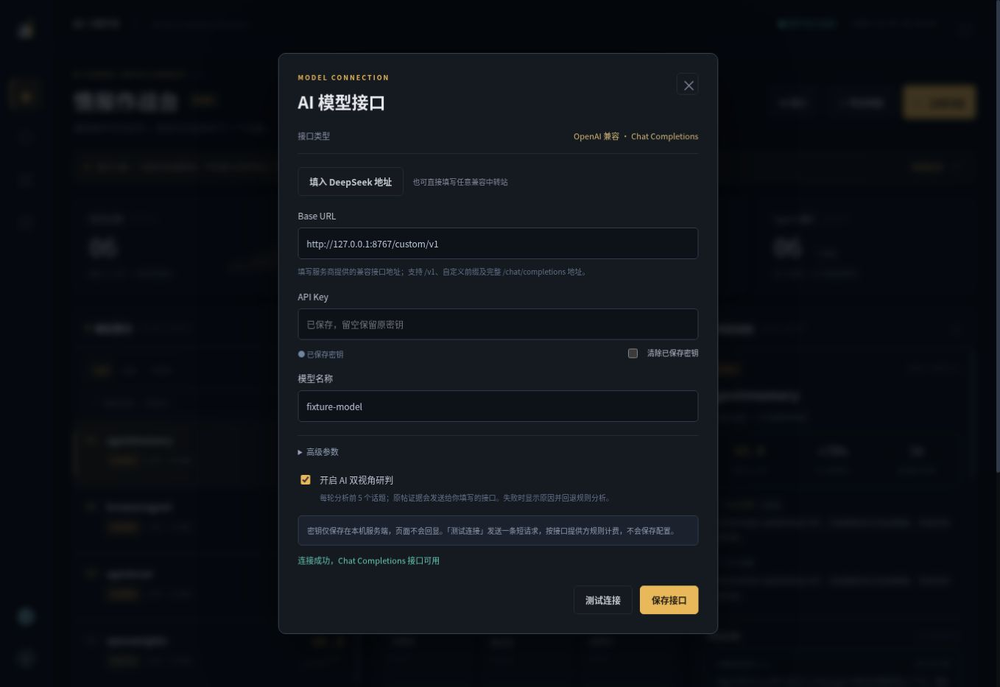

# 首版验收记录

日期：2026-11-10。v0.1 记录为免费浏览器采集单机版；当前 v0.2 已统一使用 OpenAI 兼容模型接口，详见下方更新。

## 已通过

- 本机 `python -m unittest discover -s tests -v`：v0.1 为 26 / 26。
- `node --check web/app.js`、`node --check scripts/dev.mjs`：通过。
- 合成样本完整流程：6 个话题、378 条去重样本，六个角色均有持久化阶段记录。
- 浏览器操作：关键词搜索、加速筛选、话题选择联动趋势/证据、配置保存、模式隔离、运行档案、SSE 连接、Markdown 简报下载。
- 大屏布局：紧凑模式与原生全屏独立；浏览器拒绝原生全屏时仍可使用紧凑作战布局。
- 免费来源缺失：选择 OpenCLI 后会显示“未安装 opencli”，记录失败，不回填演示数据；恢复演示配置后可继续扫描。
- 上游结构兼容：OpenCLI `{ok,data}`、Agent Reach schema v1、X RFC 日期、`/i/status` 链接的真实作者。
- 趋势边界：冷启动、去重、窗口边界、未来时间、作者门槛、基线/加速度。
- Windows 文件占用修复：数据库事务退出时显式关闭连接，不依赖垃圾回收释放文件句柄。
- 一致性：拒绝任务重叠，执行中可取消，取消前置竞争处理，失败保留旧快照，重启标记中断，限流冷却。
- 模型证据边界：引用非证据 ID 失败，模型故障明确回退规则；当前接口规则见 v0.2 更新。
- 本机会话与来源限制：未登录会话拒绝、跨站写入拒绝、输入校验、静态页面 CSP。

## 模型接口更新（v0.2）

- 移除专用本地模型协议，统一支持 OpenAI 兼容 Chat Completions。
- 顶部 AI 接口表单可配置地址、密钥、模型、超时与输出上限，保存和测试分开。
- 41 项本地自动测试覆盖原功能与兼容协议、密钥持久化、脱敏、改地址不沿用旧密钥、配置版本隔离、JSON 回退、401/429 错误与证据校验。
- 浏览器 + 本机假接口实测：401 错误提示、连接成功、保存/重开密钥不回显、留空复用密钥、前 5 个话题的双角色研判均通过。未调用真实第三方商业接口。
- Windows / Linux CI 结果以对应 PR 的记录为准。

## 尚未现场验证

当前环境没有已登录 X 的浏览器，也没有用户的真实第三方模型密钥。因此真实 X 连续采集、24 小时稳定性、第三方模型现场质量与额度行为仍需用户本机验收。兼容模型功能使用 Mock 和本机假接口测试，不宣称商业服务真实调用已完成。

## 后续工作

1. 在用户的已登录 X 本机完成上述现场验收，记录工具版本、实际采样量与时间覆盖。
2. 根据连续真实样本校准阈值、查询词与增长误报，增加抽样缺口监测。
3. 本地 embedding 聚类、别名/中英文归并，提高同事件聚合质量。
4. 话题历史快照与跨日走势、事件保留期、单实例文件锁。
5. 用户需要时再加免费本地通知、关注账号/列表源与多轮研究任务。

CI 配置覆盖 Ubuntu / Windows × Python 3.12 / 3.13；远端运行结果以 PR 检查为准。
