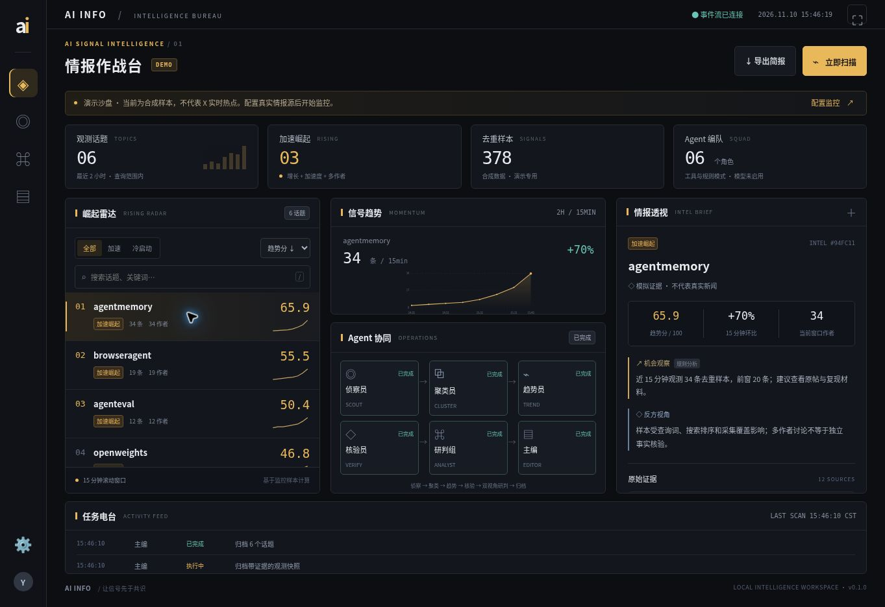

# 首版验收记录

日期：2026-11-10。范围：免费单机版，不含 X 官方付费 API 和收费云端模型。

## 已通过

- 本机 `python -m unittest discover -s tests -v`：25 / 25。
- `node --check web/app.js`、`node --check scripts/dev.mjs`：通过。
- 合成样本完整流程：6 个话题、378 条去重样本，六个角色均有持久化阶段记录。
- 浏览器操作：关键词搜索、加速筛选、话题选择联动趋势/证据、配置保存、模式隔离、运行档案、SSE 连接、Markdown 简报下载。
- 大屏布局：紧凑模式与原生全屏独立；浏览器拒绝原生全屏时仍可使用紧凑作战布局。
- 免费来源缺失：选择 OpenCLI 后会显示“未安装 opencli”，记录失败，不回填演示数据；恢复演示配置后可继续扫描。
- 上游结构兼容：OpenCLI `{ok,data}`、Agent Reach schema v1、X RFC 日期、`/i/status` 链接的真实作者。
- 趋势边界：冷启动、去重、窗口边界、未来时间、作者门槛、基线/加速度。
- 一致性：拒绝任务重叠，执行中可取消，取消前置竞争处理，失败保留旧快照，重启标记中断，限流冷却。
- 本地模型边界：拒绝远程主机与 Cloud 模型名，引用非证据 ID 失败，模型故障明确回退规则。
- 本机会话与来源限制：未登录会话拒绝、跨站写入拒绝、输入校验、静态页面 CSP。

## 尚未现场验证

当前执行环境没有安装 OpenCLI / Agent Reach、没有已登录 X 的浏览器，也没有 Ollama 本地模型。因此以下不能声称已通过：

- 真实 X 会话的端到端搜索与连续采集；
- 在用户机器上保持 24 小时监控、限流恢复与实际覆盖率；
- 本机 Ollama 的真实推理速度、模型质量与并发显存开销。

采集接口已经按照核查到的当前上游源码实现，并有 Mock / 参数 / 解析回归；真实验收应按 FREE_SETUP.md 在已登录 X 的本机执行。没有凭据也能使用隔离演示体验完整页面。

## 后续工作

1. 在用户的已登录 X 本机完成上述现场验收，记录工具版本、实际采样量与时间覆盖。
2. 根据连续真实样本校准阈值、查询词与增长误报，增加抽样缺口监测。
3. 本地 embedding 聚类、别名/中英文归并，提高同事件聚合质量。
4. 话题历史快照与跨日走势、事件保留期、单实例文件锁。
5. 用户需要时再加免费本地通知、关注账号/列表源与多轮本地研究任务。

CI 配置覆盖 Ubuntu / Windows × Python 3.12 / 3.13；远端运行结果以 PR 检查为准。
