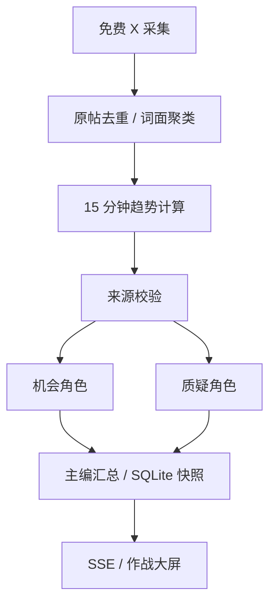

# 架构与趋势算法

## 数据流

OpenCLI Latest 与 Agent Reach 热门搜索是手动选择的两个免费入口。演示样本独立处理，不进入真实帖子表。规则流程覆盖所有话题，兼容接口模型仅分析前 5 个话题；双角色并发，最多 2 个话题同时进行。无外部工具调用的模型角色不能访问链接或执行原帖指令。

## 组件

| 文件 | 职责 |
| --- | --- |
| `intel/models.py` | 输入校验、Post、监控配置、查询范围指纹 |
| `intel/sources.py` | 固定只读 CLI、跨平台进程、日期解析、来源归一化、模拟样本 |
| `intel/analysis.py` | 去重、聚类、趋势公式、来源校验、双视角角色、简报 |
| `intel/llm.py` | OpenAI 兼容 Chat Completions、连接测试、错误与 JSON 兼容处理 |
| `intel/runner.py` | 固定 DAG、并发限制、取消、阶段事件、失败与限流状态 |
| `intel/store.py` | SQLite WAL、帖子、配置、运行记录、事件、当前快照 |
| `intel/app.py` | 本机会话、配置/运行/事件/简报 API、静态页面 |
| `web/` | 中文大屏与配置界面，无第三方 CDN 或编译依赖 |

## 可解释趋势分

按发布时间生成 8 个 15 分钟滚动窗口。当前窗 `c`，上一窗 `p`，更早一窗 `q`，当前窗独立作者数 `u`：

- 增长率：`g = (c - p) / max(p, 3)`，展示为百分比。
- 加速度：`a = (c - p) - (p - q)`，单位为每窗新增样本变化，不是百分比。
- 讨论量项：`v = min(1, ln(1+c) / ln(51))`。
- 作者多样性：`d = min(1, u / max(c, 1))`。
- 新鲜度：`f = exp(-距最近原帖秒数 / 3600)`。
- 总分：`100 × [0.30v + 0.30clip(g/3) + 0.15clip(a/15) + 0.15d + 0.10f]`，其中 clip 限制到 `[0,1]`。

不把点赞总量当作起势速度。独立作者来自原帖作者字段；同一作者多次发帖可以计入讨论量，但不能提高作者数。帖子 ID 与去掉 URL/空白后的完全相同文本分别去重。

状态规则：

| 状态 | 条件 |
| --- | --- |
| 冷启动 | `p < 3` 或前 7 个窗口合计小于 6；不认定持续崛起 |
| 加速崛起 | 基线足够，`c >= 3`，独立作者达到配置门槛（默认 3），`g >= 0.5`，`a > 0` |
| 持续升温 | 基线足够，样本/作者门槛达到，`g > 0` |
| 降温 | 基线足够且 `g < 0` |
| 观察中 | 其他情况 |

规则尚未经过真实长期样本校准，分数不代表概率或未来预测准确率。OpenCLI Latest 仍标记为 sampled；Agent Reach 标记为 ranked_sampled。热搜排序抽样的时间分布尤其不能视作整体讨论量变化。

## 聚类和证据

按标签或英文/中文词面特征做确定性聚合。标签优先，其他词面采用 Jaccard 重叠规则。此实现不会可靠合并中英文同义词、别名和所有同事件报道；后续可增加本地 embedding 与语义归并。

每个话题最多展示最近 12 条原帖，原文不交给模型改写。核验角色检查时间/链接/作者等证据结构，**不声称做了外部事实核查**。兼容接口模型输出必须是 JSON，且引用 ID 为给定原帖 ID 的非空子集；失败回退规则并在页面标记。引用合法性不等于模型结论必然正确。

## 运行一致性

- 同一进程最多一轮任务。多查询最多并发 2 个，核验并行。
- 当前任务冻结配置，执行中禁止修改监控配置。
- 所有阶段成功后才发布快照；失败/取消保留上一份完整结果。
- 真实已采集帖子可在后续轮次继续作为历史样本，发布时间超过 2 小时不参与本轮统计；数据库帖子保留最多 7 天。
- mode、查询集合、作者门槛、模型开关及启用时的模型配置版本组成命名空间；新任务不会读取不同范围的旧快照。
- 默认 300 秒间隔，可配置 60–86400 秒；服务退出时取消调度和活动任务。
- 限流进入至少 3600 秒冷却；登录/安装/平台阻断会关闭自动扫描，待用户处理。
- SSE 使用事件 ID、断线续传和心跳，前端同时做低频状态对账；已有快照不会因断线清空。
- 进程重启时将未完成记录标记 interrupted。当前不支持多个服务进程共享同一 data 目录；只启动单实例。

## 接口

| 接口 | 用途 |
| --- | --- |
| GET `/api/session` | 本机会话初始化 |
| GET `/api/health` | 存活检查 |
| GET `/api/state` | 配置、能力、当前快照、角色、最近任务/事件 |
| PUT `/api/settings` | 保存监控配置，运行中返回 409 |
| GET / PUT `/api/model` | 读取公开模型配置 / 保存配置，永不返回原密钥 |
| POST `/api/model/test` | 测试尚未保存的兼容接口配置 |
| POST `/api/runs` | 发起一轮扫描，运行中返回 409 |
| POST `/api/runs/cancel` | 取消活动任务 |
| GET `/api/events` | SSE，支持 Last-Event-ID |
| GET `/api/brief` | 当前完整快照的 Markdown 简报 |

默认本机回环监听，同源限制、会话令牌、CSP、原文转义；API 不返回浏览器凭据。日志只记录受控错误，不透传上游原始 stderr。模型请求只使用用户明确配置的 OpenAI 兼容接口，远程使用 HTTPS，不使用环境代理、不跟随重定向。密钥私存 SQLite，不进入 API 响应、事件与简报；更换地址不会自动沿用旧密钥。

## 当前边界

首版运行/事件历史已持久化，话题完整快照每个任务范围保留最新一份；没有跨日历史图表、通知推送、团队权限、动态工具规划或多轮自主深度研究。事件/运行记录尚无自动清理，应按使用量定期停止服务并备份数据。
